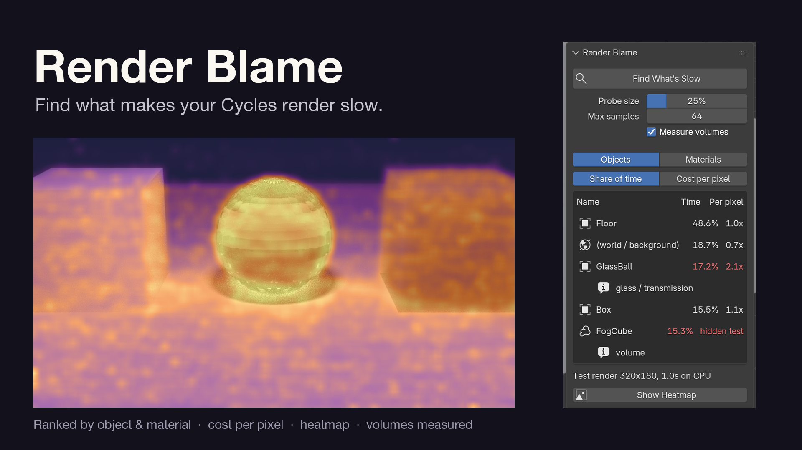
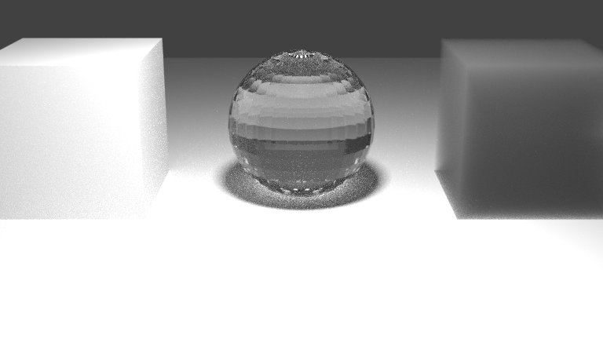
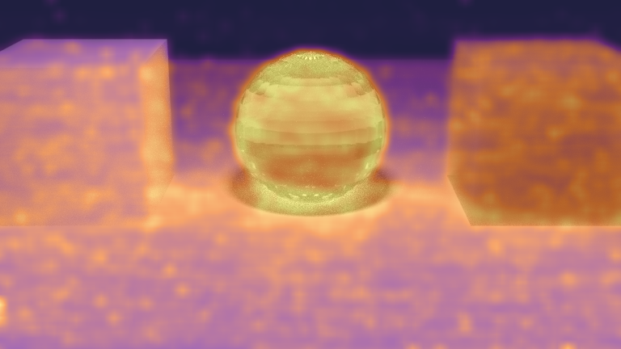

# Render Blame

**Find which objects and materials make your Cycles render slow.**



Blender tells you a frame took 4 minutes. It doesn't tell you *why*. Render Blame
does: press **Find What's Slow** and you get a ranked list —

| Object | Share of render time | Cost per pixel |
|---|---|---|
| GlassBall | 16.9% | **2.0×** average · glass / transmission |
| FogCube | **13.8%** | volume |
| Box | 15.3% | 1.1× |

— plus a heatmap of where the time goes in the frame.

 

## How it works

1. Your file is saved as a **copy** to the temp folder; your scene is never changed.
2. A background Blender renders that copy small (25% size, ≤64 samples by default)
   with Cycles' per-pixel **Render Time** pass and **Cryptomatte** object and
   material IDs, and splits the time between whatever covers each pixel. Glass owns
   what is seen through it: the ship inside a bottle isn't blamed for the bottle's cost.
3. **Hidden costs** — some time lands on *other* pixels: volumes, glowing meshes that
   light the scene, glass and alpha that shadows pass through, mirrors. Render Blame
   measures these directly: it hides each volume, and gives each such model a plain
   material, renders again, and reports the time that disappeared
   ("plain material saves 18–19%").

Three ways to read it: **Models** (default — an imported model's parts summed, so
"Object_2" becomes "socha_100kuw"), **Objects** and **Materials**. Two numbers per row:
- **Share of time** — the time spent on its pixels. Big things on screen win here even
  when they're cheap. It is not what deleting it would save: hide a wall and the wall
  behind it costs the same.
- **Cost per pixel** — how expensive each of its pixels is compared with the average.
  This is the one that finds the culprit: a small glass object at 3× is the thing to fix.

The test render always runs on the **CPU**, because Cycles only writes the Render
Time pass there. That doesn't matter for the answer — it's the *relative* cost of
each object you want — and it keeps Blender free while it measures.

**Checked against reality** on five Sketchfab models: predictions within a few percent
of the time actually saved — see [tests/REALWORLD.md](tests/REALWORLD.md).

## Install

Blender 5.0 or newer. Download `render_blame-<version>.zip` from Releases, then
*Edit ▸ Preferences ▸ Get Extensions ▸ ⌄ ▸ Install from Disk*.

Open the **Render Blame** tab in the 3D Viewport sidebar (N), or
*Properties ▸ Render ▸ Render Blame*.

## Develop

```bash
./tests/run_tests.sh                 # end-to-end checks in headless Blender
blender --command extension build --source-dir render_blame --output-dir dist
```

## License

GPL-3.0-or-later.
